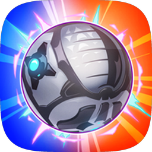

<div align="center">



# RLSS Linux

**Play Rocket League Sideswipe on Linux**, packaged as one AppImage.

No Android emulator, no virtual machine. The game's Android libraries run
directly on your Linux desktop.

[Download](../../releases) · [Build it yourself](#build-it-yourself) · [License](#license)

</div>

---

## Features

- 🎮 **One file:** a single AppImage that runs on any distribution from 2022 on.
- 🖥️ **Fullscreen** by default (**F11** toggles a window).
- 🔐 **Epic login:** the login page opens in your browser and comes back to the game.
- 🕹️ **Controllers:** Xbox, PlayStation and generic gamepads, plus mouse and keyboard.
- 🔊 **Sound** through PulseAudio / PipeWire.
- 💻 **PC and ARM:** `x86_64` for normal PCs, `aarch64` for ARM64 Linux (Raspberry Pi 5, ARM laptops).

## Download

Get the AppImage for your machine from **[Releases](../../releases)**:

| File | For |
|---|---|
| `RLSS-Linux-x86_64.AppImage` | normal PCs (Intel / AMD) |
| `RLSS-Linux-aarch64.AppImage` | ARM64 Linux |

The releases **do not contain the game**. You need the Rocket League Sideswipe
APK from the [Epic Games Store](https://store.epicgames.com/mobile) for Android.

## Play

```bash
chmod +x RLSS-Linux-x86_64.AppImage
./RLSS-Linux-x86_64.AppImage
```

On first start the AppImage looks for the game APK. Use any of these:

1. **Put the APK next to the AppImage.** The newest `*.apk` in the same folder is used.
2. **Pick it.** If no APK is found, a file picker opens, and your choice is remembered.
3. **Point to it:** `RLSS_APK=/path/to/game.apk ./RLSS-Linux-x86_64.AppImage`

| Key | Action |
|---|---|
| F11 | fullscreen / window |
| Esc | back |
| Mouse | touch |

Game data and your login are stored in `~/.local/share/apk-launcher/`.

## Build it yourself

You can build an AppImage that **already contains the game**. It starts
straight away and appears in your app menu.

**1. Get the sources.** This project needs
[mcpelauncher-manifest](https://github.com/minecraft-linux/mcpelauncher-manifest)
next to it:

```bash
git clone https://github.com/randoms67/rlss-linux.git
git clone https://github.com/minecraft-linux/mcpelauncher-manifest.git
git -C mcpelauncher-manifest checkout fb58aa2dbd966573844fc3fe53dadcddb6719009
git -C mcpelauncher-manifest submodule update --init --recursive
```

**2. Put the game APK in `apk/`.**

```
rlss-linux/
└── apk/
    └── rocket-league-sideswipe.apk   ← any name ending in .apk
```

**3. Build.** You need **docker** or **podman**; everything else happens in a container.

```bash
cd rlss-linux
./build.sh            # → dist/RLSS-Linux-x86_64.AppImage
./build.sh aarch64    # → dist/RLSS-Linux-aarch64.AppImage
./build.sh all        # both
```

With no APK in `apk/`, the same command builds the launcher-only AppImage that
the releases contain. To update the game, replace the APK in `apk/` and run
`./build.sh` again. The first build takes a while; later ones are much faster.

> APK files are ignored by git, so they are never uploaded. Don't share an
> AppImage that contains the game: the game belongs to Psyonix / Epic Games.

## How it works

Rocket League Sideswipe is an Unreal Engine 4 game whose code is built for
**ARM** phones. RLSS Linux:

- **Loads the game** with a port of the Android linker, and maps Android's libc
  onto Linux's ([libc-shim](https://github.com/minecraft-linux/libc-shim)).
- **Fills in Android's role:** window, OpenGL ES, input, sound, files, and the
  Java calls Unreal Engine makes.
- **Runs the ARM code on a PC** with a bundled QEMU translator. Graphics still
  use your real GPU through virglrenderer.
- **Handles the Epic login:** it registers the game's `eos.…://` login link, so
  your browser can hand the login back to the game.

`patches/libc-shim-fixes.patch` holds the fixes the game needs in libc-shim:
semaphores, clocks, file flags and network protocols.

### Performance

On ARM64 Linux the game runs natively. On a **PC**, every ARM instruction is
translated, which costs a lot of CPU time. A modern CPU gives playable frame
rates; older CPUs (around 2013 and earlier) may only reach single digits.
Lower graphics settings in the game help. Only Psyonix could make a faster,
native x86 version.

## Automatic releases

`.github/workflows/build.yml` builds both AppImages on GitHub:

| You do | GitHub does |
|---|---|
| push to `main` | rebuilds the **`continuous`** pre-release |
| push a tag `v1.0.0` | publishes release **v1.0.0** |

```bash
git tag v1.0.0
git push origin v1.0.0
```

If publishing fails, set **Settings → Actions → General → Workflow permissions**
to *Read and write*.

## Troubleshooting

| Problem | Fix |
|---|---|
| The login page doesn't return to the game | Keep the game open while logging in. |
| Very low FPS on a PC | Expected on older CPUs (see [Performance](#performance)). |
| Black screen | Install your distribution's `virglrenderer` package, or start with `APK_LAUNCHER_VIRGL=bundled`. |
| It crashed | Start the AppImage from a terminal and look at the lines after `Signal … received`. |
| Start fresh | Delete `~/.local/share/apk-launcher/` and `~/.config/rlss-linux/`. |

## License

[GPL-3.0](LICENSE). RLSS Linux builds on
[mcpelauncher](https://github.com/minecraft-linux/mcpelauncher-manifest)
(GPL-3.0).

Rocket League Sideswipe and its icon are trademarks of Psyonix / Epic Games.
This project is not affiliated with them and does not include or distribute
the game.
